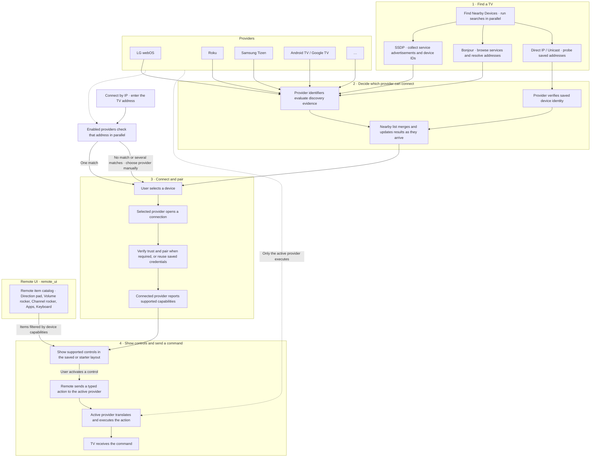
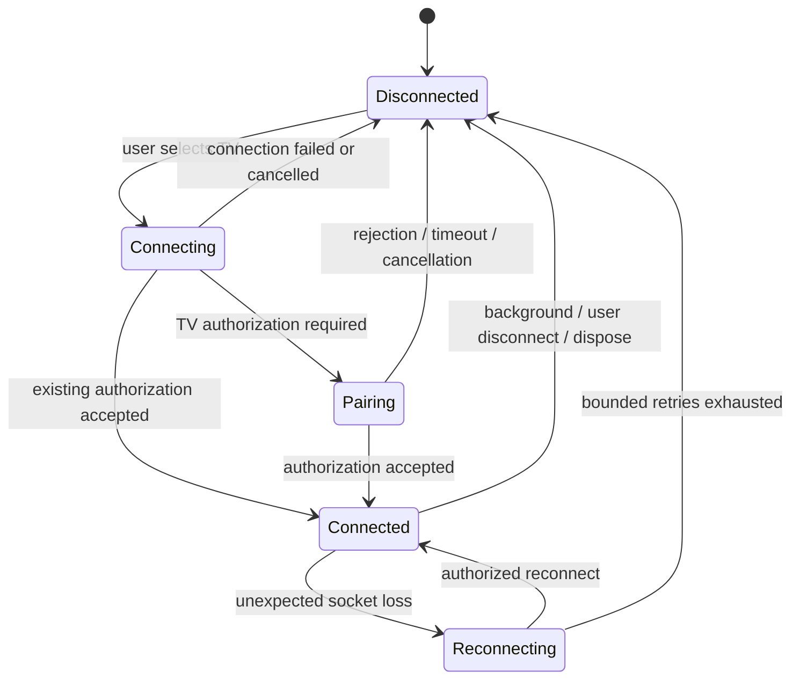

# Architecture

The current folder map and readability conventions are in
[contexts/flutter/project-structure.md](contexts/flutter/project-structure.md) and
[contexts/architecture/readability-rules.md](contexts/architecture/readability-rules.md).
Navigation uses DEVCOM route_definer 4.0.0 at a verified, pinned Git revision.

Universal Remote is a Pub workspace. The app and `remote_ui` use Flutter.
`remote_core`, `remote_network`, and the provider packages use Dart.
Native storage and platform adapters are wired in the app.

## From finding a TV to controlling it

The three lanes are shared discovery mechanisms. Each provider and service
search runs independently, so one failure or timeout appears in **Search details**
while other searches can still add devices to the list. Provider identifiers
decide which responses they recognize. An **SSDP USN** is an identifier inside
a reply that a provider can use to distinguish devices.
Matching evidence updates the same row. A TV can appear in Nearby before
pairing, and **Connect by IP** works independently of discovery.

LG webOS, Android TV / Google TV, and Samsung Tizen are registered by default.
Roku is opt-in for development builds. Bluetooth accessory controls on supported
TVs are separate from TV discovery. Amazon Fire TV has no registered provider
in this version.

## Injection and ownership

Following the Kap Games approach, `AppBootstrap.initialize` is the composition
root. It assembles the credential adapter, provider registry, saved-device
repository, discovery/connection/settings controllers, and returns a concrete
`AppDependencies` object. The root app and screens receive it through their
constructors. Domain services also receive their dependencies through constructors.
There is no Riverpod, GetIt, global service locator, or hidden dependency lookup.

`ValueNotifier` owns UI state; `ValueListenableBuilder` and `ListenableBuilder`
render it. Discovery, selected device, connection/pairing, volume/command progress,
saved profiles, and settings have separate observable values. Protocol state
remains in the provider clients. Tests replace storage, providers, and transports. Bootstrap uses native preferences
for profiles/settings and a separate secure adapter only for pairing keys. It does
not access Keychain during normal startup.

The app owns `AppDependencies` and disposes it once. Cleanup futures are reused
so callers can await an in-progress disposal. A DeviceSession owns its driver and state subscription; VolumeObserver owns
volume updates, and RemoteCommandController owns command progress/error handling.
LG capability controllers depend on a command channel or pointer connection
rather than their device owner. Device clients own SSAP and pointer
sockets, request timers, subscription timers, reconnect timers, and subscriptions.
Discovery owns its UDP socket and always releases the native multicast lock.

## Protocol discovery and device identity

`AppBootstrap` registers SSDP and Bonjour searches in `DiscoveryRegistry`.
`DiscoveryManager` runs each provider's service searches in parallel, even when
they use the same protocol. Each search has its own status, timeout and
cancellation token. The app listens to an immutable stream of merged device
snapshots. Repeated matches update the existing device when the evidence
establishes the same identity. Provider and protocol identities use enums, and
saved profiles retain their existing provider IDs.
`LgIdentifier`, `AndroidTvIdentifier`, `SamsungIdentifier`, and `RokuIdentifier`
validate evidence and produce provider-specific connection profiles. Identification never creates a
controller. Unknown or ambiguous results remain visible in discovery without a
Connect action.

`DeviceIdentifierResolver` scopes identity to the integration. A matching
certificate fingerprint can correlate an Android TV after DHCP renewal. LG, Samsung and
Roku service identities are namespaced and also require the same endpoint unless
stronger evidence is available. Addresses, friendly names and unverified MAC
addresses cannot establish an identity. Different integrations can be linked in
Device details with explicit user confirmation and unlinked later.

`ProviderRegistry` selects factories from `ProviderDefinition` and delegates
optional manual, certificate and wake policies. Existing controllers own the
commands, pairing and transports. The app and test fixtures use the protocol manager for discovery.

`saved-devices.v2` stores logical IDs, display names and provider profiles.
`dashboards.v2` stores layouts, and the secure store uses
`client-key.v2.<profile-id>`. V2 ignores old device data and leaves it untouched.
Corrupt V2 data is reported and preserved. Device associations and provider
preference do not grant authorization.

## Capabilities

`TVRemoteBase` and `ACRemoteBase` expose every command directly (for example
`volumeUp()`, `press(key)`, `setTargetTemperature()`); core does not care how a
provider splits the work. Unsupported commands throw `RemoteException`, and
`supports(RemoteCapability)` reports driver evidence. The LG driver delegates to
internal per-feature controllers.
Evidence records source and availability separately; see capability-model.md.
The UI knows these interfaces and contains no SSAP URI strings.

## Remote dashboard

Remote and Devices share the existing indexed main shell. The live remote and
editor use a single grid, with a starter grid for devices without an active
saved dashboard. `packages/remote_ui` separates the editor, catalog,
renderer and shared `UniversalRemoteItem`.

The `remote_ui` workspace package owns item definitions, catalog eligibility,
geometry and the shared item shell. Standard, TV and AC definitions share a
registry. Provider lifecycle contracts remain in `remote_core`. Dashboards use a
separate local repository.
Saved grids contain serializable identifiers and configuration. Dart callbacks
are supplied by the compiled definitions. See [the migration plan](migration-plan.md)
for the remaining control families and storage work.

## Transport boundary

`TextTransport` is an injectable text-frame connection. `IoWebSocketTransport`
uses the SDK WebSocket and exposes socket state. SSAP owns JSON framing, request
IDs, registration, subscriptions, and correlation. Navigation uses a different
socket and blank-line-delimited text. SSDP and WOL are separate UDP responsibilities.

## Provider-owned policy and grouped core contracts

`remote_core` exposes `RemoteBase`, `TVRemoteBase` and `ACRemoteBase` in
three files. Each file groups its capability interfaces and value types with
the corresponding base. Shared device records and provider interfaces are
grouped in `device.dart` and `provider.dart`. Older controller type names
remain available as aliases. Provider implementation files still follow
the one-type-per-file rule.

`ConnectionController.connect(device)` opens a session. `turnOn(device)` sends
wake once and retries the connection through the same workflow used by the
app's observable session adapter. The provider classifies startup errors and
owns connection settings, legacy category mapping, and certificate policy.
Core owns discovery identity matching and optional wake-address learning.
The app supplies the platform address lookup and profile persistence callbacks.
For a network connection failure, the coordinator may try one other confirmed
profile with its own saved authorization. Pairing, certificate and command
failures do not trigger failover. No commands are replayed.

The grid editor's draft, sizing, undo/redo and save workflow live in
`remote_ui`. It calls the app's `DashboardStore` adapter for persistence.
