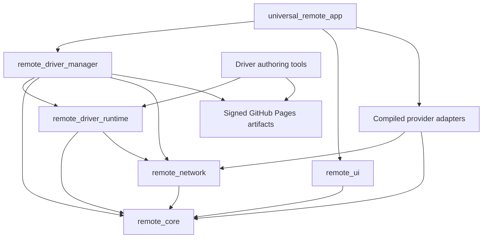

# Driver validation and release gates

## Dependency boundaries

The app assembles the existing provider registry and supplies platform signature verification, storage, and protected credentials. The manager owns version selection, distribution and activation. The runtime validates bounded workflows and uses the same network transports as the compiled engines.



## Automated checks

Run these commands from the repository root with the pinned Flutter SDK.

```sh
flutter pub get --enforce-lockfile
dart format --output=none --set-exit-if-changed packages apps/universal_remote_app/lib apps/universal_remote_app/test test tool
dart analyze --fatal-infos
dart run tool/check_structure.dart
dart run tool/audit_dependencies.dart
PYTHONDONTWRITEBYTECODE=1 python3 -m unittest discover -s drivers/tests
dart test test packages/remote_core/test packages/remote_network/test packages/remote_driver_runtime/test packages/remote_driver_manager/test packages/remote_lg_webos/test packages/remote_android_tv/test packages/remote_roku/test packages/remote_samsung_tizen/test
cd apps/universal_remote_app
flutter test --no-pub
flutter build apk --release --no-pub
flutter build ios --simulator --debug --no-pub
flutter build macos --debug --no-pub
```

The signed distribution fixture covers catalog and package verification, revision rollback, transfer deduplication, Nearby discovery, choosing a compatible driver, first installation and offline manual reconnect. Existing provider fixtures cover preserved transport behavior. Publication tests build the full release index with an ephemeral key and check that each artifact is available at the path signed in the catalog.

## Platform and compatibility limits

- The generic controller currently exposes relative volume and power off for supported declarative commands. The runtime also provides persistent JSON pairing and subscriptions for host integrations. Other protocols need a compatible compiled engine or a new approved runtime primitive.
- Existing LG, Android TV, Samsung and Roku controllers retain their compiled protocol engines. The managed releases externalize the wire mappings listed in the [provider inventory](current-provider-inventory.md). Their signed profiles represent compatibility with those engines and make no firmware-specific guarantees.
- Device OS, model and firmware constraints require matching evidence. Unknown evidence can match a generic profile. Firmware range comparison requires a strategy for the particular platform.
- Native signature verification is configured on Android, iOS and macOS. Apple Bonjour services must also be declared in the app bundle. A newly introduced Bonjour service type can require an app release on Apple platforms. [Apple local network privacy](https://developer.apple.com/documentation/technotes/tn3179-understanding-local-network-privacy)
- Driver releases contain declarative data. A native operation or executable protocol engine ships through the app release process. App Store review and Google Play policy remain separate release gates. [Apple App Review Guidelines](https://developer.apple.com/app-store/review/guidelines/) · [Google Play Device and Network Abuse policy](https://support.google.com/googleplay/android-developer/answer/16559646)

## Release and hardware verification

Production deployment requires a configured Pages source, protected environment, production signing key, and a release build with the corresponding trusted public key. Follow [publishing](publishing.md) and confirm that the deployment URL serves the exact catalog and package paths. The feature branch validates signing with ephemeral keys.

Exercise at least one physical TV per enabled provider before claiming hardware compatibility.

| Target | Verify on hardware |
| --- | --- |
| LG webOS | Existing saved profile, registration and TLS, navigation and pointer, volume and mute, apps, inputs, wake. |
| Android TV | Pairing code, TLS pin and reconnect, navigation, media, volume and wake on a supported device. |
| Samsung Tizen | Certificate and token persistence, navigation, channels, volume, app launch and wake. |
| Roku development build | Local ECP discovery and serial match, permission and capability gates, volume and power on supported hardware. |
| Cross-provider | First install, disconnected catalog, reconnect without Internet, persisted dashboards and credentials, update during an active session, and rollback. |
